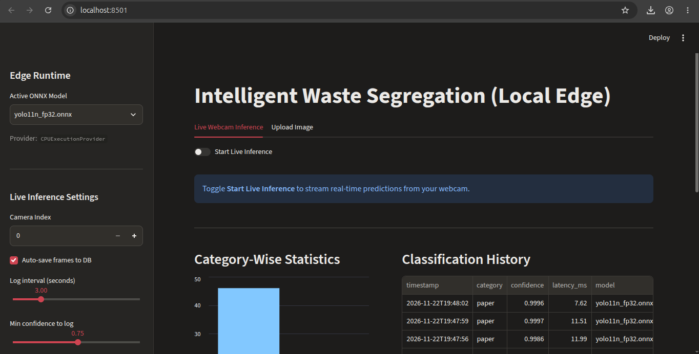
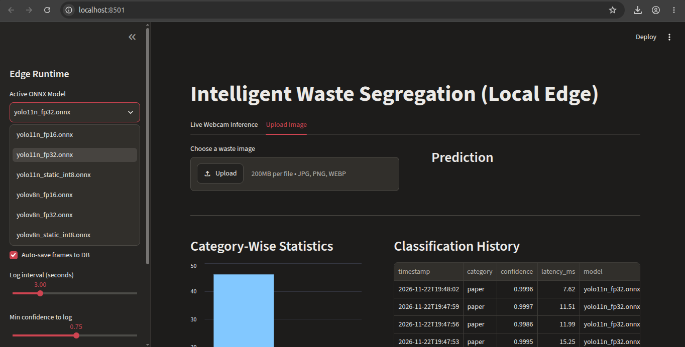
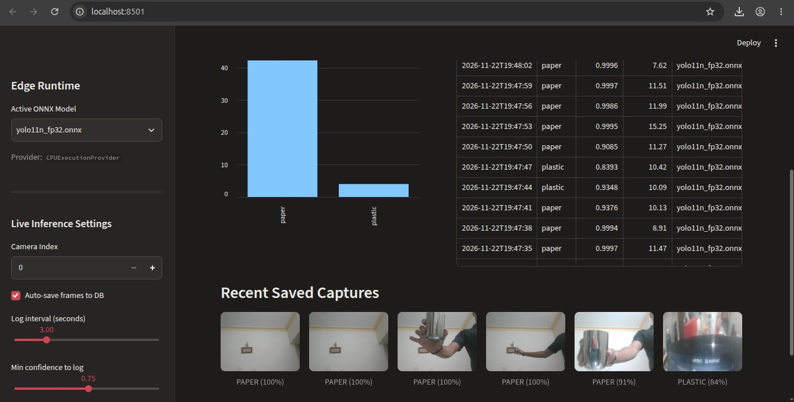

# Edge Waste Segregation System

[](https://www.python.org/)
[](https://fastapi.tiangolo.com)
[](https://streamlit.io)
[](https://onnxruntime.ai/)
[](https://opensource.org/licenses/MIT)

An intelligent, real-time edge AI solution for automated waste classification and segregation guidance. Powered by optimized ONNX models (YOLO11n and YOLOv8n) with static INT8 quantization as well as FP16 and FP32 precision variants, this system delivers low-latency inference on local hardware without cloud dependency.

<p align="center">
  
</p>

---

## Table of Contents

- [Overview](#overview)
- [Key Features](#key-features)
- [Supported Waste Categories](#supported-waste-categories)
- [System Architecture](#system-architecture)
- [Repository Structure](#repository-structure)
- [Installation and Setup](#installation-and-setup)
- [Adding and Managing Models](#adding-and-managing-models)
- [Local Testing Guide](#local-testing-guide)
  - [1. Quick CLI Smoke Test](#1-quick-cli-smoke-test)
  - [2. Testing with the Streamlit Dashboard](#2-testing-with-the-streamlit-dashboard)
  - [3. Testing with the FastAPI Service](#3-testing-with-the-fastapi-service)
- [Audit History and Capture Gallery](#audit-history-and-capture-gallery)
- [API Reference](#api-reference)
- [Model Zoo and Specifications](#model-zoo-and-specifications)
- [License](#license)

---

## Overview

Proper waste segregation at source is essential for recycling efficiency and environmental sustainability. This project provides a production-grade edge deployment that classifies discarded materials via webcam or uploaded images, displays disposal rules, logs detections into a local database, and exposes REST endpoints for smart bin automation.

---

## Key Features

- **Edge-Optimized Inference:** High-throughput ONNX Runtime pipeline supporting multi-threaded CPU execution and automatic CUDA GPU acceleration when available.
- **Dynamic Model Switching:** Hot-swap between YOLOv8n and YOLO11n models (INT8, FP16, FP32) at runtime without restarting the application.
- **Real-Time Webcam Stream:** Live OpenCV video capture with instant overlay display, category prediction, confidence scoring, and latency in milliseconds.
- **Automated Capture Logging:** Captures and timestamps high-confidence frames to the `captures/` folder and stores metadata in a local SQLite database (`history.db`).
- **Interactive Analytics Dashboard:** Streamlit dashboard showcasing real-time category distribution charts, recent capture galleries, and classification audit logs.
- **RESTful API:** Complete FastAPI backend with OpenAPI and Swagger documentation, health checks, prediction endpoints, and history metrics.

---

## Supported Waste Categories

The classification engine maps inputs to five standard categories with disposal guidance:

| Category | Recommended Bin | Actionable Disposal Guidance |
| :--- | :--- | :--- |
| **Glass** | Blue Bin (Dry Recyclable) | Rinse thoroughly and remove metal caps or lids. |
| **Metal** | Blue Bin (Dry Recyclable) | Empty, rinse, and crush aluminium cans if possible. |
| **Organic** | Green Bin (Wet/Compostable) | Food scraps, peels, and biodegradable matter for composting. |
| **Paper** | Blue Bin (Dry Recyclable) | Keep dry, clean, and flatten cardboard boxes. |
| **Plastic** | Blue Bin (Dry Recyclable) | Clean, dry, and verify resin identification code. |

---

## System Architecture

```text
       [ Webcam / Image Upload ]
                   |
                   v
       +-----------------------+
       | OpenCV Pre-processing |  (224x224 RGB, Normalized blob)
       +-----------+-----------+
                   |
                   v
       +-----------------------+
       |  ONNX Runtime Engine  |  (YOLO11n / YOLOv8n : INT8 / FP16 / FP32)
       +-----------+-----------+
                   |
                   v
        [ Category & Confidence ]
         |                     |
         v                     v
+------------------+  +------------------+
|  Streamlit UI    |  |  FastAPI Server  |
|  - Live Video    |  |  - /predict      |
|  - Analytics     |  |  - /models       |
|  - Captures View |  |  - /history      |
+--------+---------+  +--------+---------+
         |                     |
         +----------+----------+
                    |
                    v
          [ SQLite (history.db) ]
          [ Local Captures Dir  ]
```

---

## Repository Structure

```text
edge_app/
├── app.py                # FastAPI application and REST API routes
├── inference.py          # WasteClassifier inference engine using ONNX Runtime
├── streamlit_app.py      # Streamlit web dashboard (webcam, upload, analytics)
├── requirements.txt      # Python package dependencies
├── history.db            # SQLite database for audit history (git-ignored)
├── captures/             # Automated capture storage directory
│   └── .gitkeep
├── docs/                 # Documentation assets and screenshots
│   └── assets/
│       ├── dashboard_history_captures.jpg
│       ├── dashboard_live_view.png
│       └── model_selection_upload.png
├── models/               # Quantized and precision-tuned ONNX models
│   ├── yolo11n_static_int8.onnx   # Default lightweight model (~1.7 MB)
│   ├── yolo11n_fp16.onnx          # YOLO11n FP16 precision (~3.0 MB)
│   ├── yolo11n_fp32.onnx          # YOLO11n FP32 full precision (~5.9 MB)
│   ├── yolov8n_static_int8.onnx   # YOLOv8n INT8 quantized (~1.5 MB)
│   ├── yolov8n_fp16.onnx          # YOLOv8n FP16 precision (~2.8 MB)
│   └── yolov8n_fp32.onnx          # YOLOv8n FP32 full precision (~5.5 MB)
├── static/               # Static web assets for FastAPI
│   └── index.html
├── .gitignore            # Git exclusion rules
└── README.md             # Project documentation
```

---

## Installation and Setup

### Prerequisites

- Python 3.10 or newer (tested on Python 3.10 through 3.14)
- A connected USB or built-in webcam (optional, required only for live inference)
- Linux, macOS, or Windows

### Step-by-Step Installation

1. **Clone the repository:**
   ```bash
   git clone https://github.com/<your-username>/<your-repo-name>.git
   cd edge_app
   ```

2. **Create and activate a virtual environment:**
   ```bash
   # Linux / macOS
   python3 -m venv .venv
   source .venv/bin/activate

   # Windows (PowerShell)
   python -m venv .venv
   .venv\Scripts\Activate.ps1
   ```

3. **Install dependencies:**
   ```bash
   pip install --upgrade pip
   pip install -r requirements.txt
   ```

---

## Adding and Managing Models

### Where to Place Model Files

All ONNX model files must be placed directly inside the `models/` directory:

```text
edge_app/
└── models/
    ├── your_new_model.onnx
    ├── yolo11n_static_int8.onnx
    └── ...
```

### Model Requirements and Format

When exporting or adding custom models:
1. **Format:** Standard ONNX format (`.onnx`).
2. **Input Dimensions:** `1 x 3 x 224 x 224` (batch size 1, 3 color channels RGB, 224x224 pixels).
3. **Normalization:** Input images are normalized with a scale factor of `1.0 / 255.0`.
4. **Output Shape:** A 1D tensor of 5 elements corresponding to logits or probabilities for:
   `["glass", "metal", "organic", "paper", "plastic"]`
   (The inference engine applies softmax automatically if raw logits are returned).

### Automatic Model Discovery and Selection

You do not need to modify any code when adding a new model. The application dynamically scans the `models/` folder using `os.listdir()`. Once a `.onnx` file is dropped into `models/`:
- It appears immediately in the Streamlit **Active ONNX Model** dropdown.
- It becomes selectable in FastAPI via `GET /models` and `POST /models/select`.

<p align="center">
  
</p>

---

## Local Testing Guide

### 1. Quick CLI Smoke Test

Verify that ONNX Runtime, OpenCV, and your models load correctly without launching a browser:

```bash
python -c "from inference import WasteClassifier; clf = WasteClassifier(); print('Active model:', clf.active_model); print('Available models:', clf.list_models()); print('Hardware provider:', clf.providers[0])"
```

Expected output:
```text
Active model: yolo11n_static_int8.onnx
Available models: ['yolo11n_fp16.onnx', 'yolo11n_fp32.onnx', 'yolo11n_static_int8.onnx', 'yolov8n_fp16.onnx', 'yolov8n_fp32.onnx', 'yolov8n_static_int8.onnx']
Hardware provider: CPUExecutionProvider
```

### 2. Testing with the Streamlit Dashboard

Run the Streamlit web application:

```bash
streamlit run streamlit_app.py
```

Open your browser at `http://localhost:8501`.

**Testing Steps:**
1. **Live Webcam Test:**
   - Under **Live Inference Settings** in the left sidebar, verify your **Camera Index** (default is `0`).
   - Switch the **Start Live Inference** toggle on.
   - Hold an object (such as paper or a plastic bottle) in front of the camera.
   - Check the real-time classification label, confidence score, and latency displayed above the video feed.
   - If **Auto-save frames to DB** is enabled, high-confidence frames are automatically logged to `captures/` and `history.db`.

<p align="center">
  
</p>

2. **Image Upload Test:**
   - Click the **Upload Image** tab.
   - Drag and drop an image (`.jpg`, `.png`, or `.webp`).
   - Click **Classify & Save**.
   - Review the predicted category, disposal recommendation, and latency.

3. **Model Switching Test:**
   - In the left sidebar, expand the **Active ONNX Model** select box.
   - Switch between `yolo11n_static_int8.onnx`, `yolo11n_fp16.onnx`, and `yolo11n_fp32.onnx`.
   - Observe latency differences between INT8 quantization and full precision.

---

## Audit History and Capture Gallery

When running inferences, detections meeting the confidence threshold are saved locally. The lower section of the dashboard automatically renders the real-time distribution across categories, recent log records with latency benchmarks, and a visual gallery of saved capture files:

<p align="center">
  
</p>

- **Category-Wise Statistics:** Real-time distribution chart indicating detection counts per class.
- **Classification History Table:** Logs timestamps, categories, confidence scores, latencies in ms, and active model names.
- **Recent Saved Captures:** Thumbnail strip showing the latest classified frames with category tags and confidence percentages.

---

## Testing with the FastAPI Service

Start the FastAPI REST backend:

```bash
uvicorn app:app --host 0.0.0.0 --port 8000 --reload
```

### Testing via cURL

1. **Check available models:**
   ```bash
   curl http://localhost:8000/models
   ```

2. **Send an image for classification:**
   ```bash
   curl -X POST "http://localhost:8000/predict" \
        -H "accept: application/json" \
        -H "Content-Type: multipart/form-data" \
        -F "file=@/path/to/sample_waste.jpg"
   ```

   Sample response:
   ```json
   {
     "category": "paper",
     "confidence": 0.9986,
     "recommendation": "Blue Bin (Dry Recyclable) : Keep dry and flatten cardboard.",
     "model": "yolo11n_static_int8.onnx",
     "provider": "CPUExecutionProvider",
     "latency_ms": 7.62
   }
   ```

3. **Switch active model:**
   ```bash
   curl -X POST "http://localhost:8000/models/select" \
        -H "Content-Type: application/json" \
        -d '{"model_name": "yolo11n_fp32.onnx"}'
   ```

4. **Query classification history and statistics:**
   ```bash
   curl "http://localhost:8000/history?limit=5"
   curl "http://localhost:8000/stats"
   ```

5. **Interactive Swagger UI:**
   Open `http://localhost:8000/docs` in your browser to execute API calls directly from the interactive documentation.

---

## API Reference

| HTTP Method | Route | Description |
| :--- | :--- | :--- |
| `GET` | `/models` | Returns active model, list of available models, and active execution provider. |
| `POST` | `/models/select` | Switches the active model dynamically (`{"model_name": "..."}`). |
| `POST` | `/predict` | Uploads an image file (`multipart/form-data`) and returns category, confidence, and latency. |
| `GET` | `/history?limit=20` | Returns recent classification records from the local SQLite database. |
| `GET` | `/stats` | Returns aggregate classification counts per category. |
| `GET` | `/docs` | Interactive Swagger UI documentation. |
| `GET` | `/redoc` | Interactive ReDoc documentation. |

---

## Model Zoo and Specifications

All models are stored in the `models/` folder:

| Model File | Precision | File Size | Recommended Deployment Target |
| :--- | :---: | :---: | :--- |
| `yolo11n_static_int8.onnx` | **INT8** | ~1.7 MB | **Recommended for Edge Devices / Raspberry Pi** (lowest RAM and CPU latency) |
| `yolo11n_fp16.onnx` | **FP16** | ~3.0 MB | Edge accelerators, Jetson devices, and GPUs with FP16 support |
| `yolo11n_fp32.onnx` | **FP32** | ~5.9 MB | Standard desktop or server CPU / GPU inference |
| `yolov8n_static_int8.onnx` | **INT8** | ~1.5 MB | Lightweight alternative quantized model |
| `yolov8n_fp16.onnx` | **FP16** | ~2.8 MB | YOLOv8 half-precision variant |
| `yolov8n_fp32.onnx` | **FP32** | ~5.5 MB | YOLOv8 baseline full-precision model |

---

## License

This project is licensed under the MIT License. See the [LICENSE](LICENSE) file for details.
